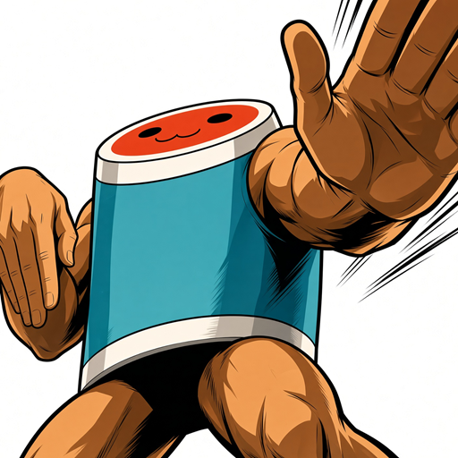

# A Better Taiko Hiroba


[中文](README.zh-CN.md)

A client-side toolkit for Donder Hiroba (donderhiroba.jp), the Japanese play-data site for Taiko no Tatsujin. It browses and changes your own play data — scores, profile, My Don, favourite songs, settings — from a desktop app, an Android or iOS app and, later, the command line, with an interface that stays out of your way. It runs on your own device and talks to Hiroba directly; none of your data passes through a server of ours.

## Download

Get the latest version from the [Releases page](https://github.com/HicirTech/A-Better-Taiko-Hiroba/releases/latest): an installer or a portable zip for Windows, a disk image for macOS (Apple silicon or Intel), an APK for Android, and an IPA for iOS ([installing it](#installing-on-ios)). The app tells you when a newer version is out.

### Installing on iOS

The app is not on the App Store. Its IPA is unsigned: you sign it with your own Apple account as you install it, and a free account is enough. It needs iOS 17.5 or later.

With [Sideloadly](https://sideloadly.io/), on a Windows PC or a Mac:

1. Download `ABTH-<version>.ipa` from the [Releases page](https://github.com/HicirTech/A-Better-Taiko-Hiroba/releases/latest).
2. Install Sideloadly. On Windows it also needs iTunes and iCloud from Apple's website, not the Microsoft Store versions.
3. Connect the iPhone or iPad with a cable, unlock it and tap **Trust**.
4. In Sideloadly, enter your Apple ID, drag the IPA in and press **Start**. Type your password and, if asked, the code Apple sends you.
5. On iOS 16 or later, turn on Developer Mode: **Settings > Privacy & Security > Developer Mode**. The device restarts and asks you to confirm.
6. If iOS says the developer is not trusted: **Settings > General > VPN & Device Management**, tap your Apple ID, then **Trust**.

A free Apple account has two limits: the app stops opening 7 days after it was signed, until it is signed again, and only 3 apps signed this way can be installed at once. Sideloadly's automatic refresh signs it again before then, while the computer is on and on the same Wi-Fi as the device. [AltStore](https://faq.altstore.io/) and [SideStore](https://docs.sidestore.io/) can sign it again from the phone once they are set up; their own guides say how. A paid developer account, or any other signing tool, works too.

In AltStore or SideStore you can also add this project's source: open **Sources**, tap **+** and paste the address below. The app is then listed there, and each new version shows up as an update.

```
https://github.com/HicirTech/A-Better-Taiko-Hiroba/releases/latest/download/altstore.json
```

To update, sign the new IPA the same way, with the same Apple ID, and install it over the old app: deleting the app first deletes everything it keeps on the device.

Download the IPA only from this project's Releases page.

## What it does

- [x] Sign in with your Bandai Namco ID and stay signed in
- [x] Show every chart you played, the most recent first: crowns, ranks, scores, hit counts, play options; each opens its scores in full, or adds its song to a set
- [x] Show your profile, My Don, title, dan rank, score counts and favourite songs
- [x] Work out your rating and skills from your scores, by OurTaiko's first or second rating, and show the charts it counts
- [x] Share your profile or your rating as a picture: copy or save it on a computer; on Android, share it, or save it from Android 11 on
- [x] See where you stand: clears by star level, by hits per second and by BPM, and the charts closest to their next crown; add the charts to work on to a set
- [x] See how things change as you read your scores: a chart's high score, your plays, crowns and score ranks, and your rating by both versions
- [x] Change your title
- [ ] Build your title part by part
- [x] Change your nickname
- [x] Change My Don's costumes and colours
- [x] Preview a costume before saving it, and go back to one you wore before
- [ ] Change your game settings
- [x] Change your favourite song and your favourites folder
- [x] Keep sets of favourite songs on your device, and swap the whole folder for one in a single save
- [x] Give up to four songs as a gift: a picture with a QR code, its songs shown or kept a mystery; scan one from a picture, or with the camera on Android, and accept it into your favourites folder
- [x] Find songs by genre, difficulty and stars, and by part of a name in Japanese, English or Chinese, with the artists and each chart's star level
- [x] Look up any song from the Overview, or open one from your favourites: its tempo, each chart's level and max combo, and pictures of its notes that open full screen and zoom
- [x] See how many notes a chart asks for each second, as a line over the song, branch by branch
- [x] See each chart drawn from its TJA file, every branch at once, drawn ahead on ABTH CDN and compressed for slow networks or drawn on your device, or taiko.wiki's pictures of it, as you choose
- [x] See what the app is asking each site, and how each request went, on a page of its own
- [ ] Browse offline, from a local database
- [ ] Hold several accounts at once
- [ ] Sync incrementally, and resume where it stopped
- [ ] Run on the command line
- [x] Run as a desktop app, on Windows
- [x] Run as a desktop app, on macOS
- [x] Run as an Android app
- [x] Run as an iOS app, from an unsigned IPA you sign yourself
- [ ] Run as a web app — later
- [ ] Drive the same core from a script, through a programmatic API
- [x] Speak English, Japanese, Simplified Chinese and Traditional Chinese
- [x] Wear the default colours or Hiroba's own, light, dark or as your system is
- [x] Tell you when a newer version is out
- [x] Show each page's tips the first time it opens: bubbles that point at what nothing on screen shows, each told once on a device, and after an update only what it brought
- [ ] Upload your scores to Kinoko

## Honest notes

**Unofficial.** This project is not affiliated with, endorsed by, or connected to Bandai Namco Entertainment. Taiko no Tatsujin and Donder Hiroba are theirs.

**Polite by default.** Hiroba is someone else's service. The app sends it at most five reads at once and one write at a time, never retries a request by itself, fetches each picture once and keeps it, and stops asking the moment you sign out. Fetching more is always something you ask for, never something that happens on its own.

**Song data from the community.** Artists, star levels, tempos and the songs' names in other languages come from [taiko.wiki](https://taiko.wiki/) and the Chinese [太鼓之達人維基](https://taiko.fandom.com/zh/) (its names are used under CC BY-SA). The pictures of the charts are drawn with [TJA Renderer](https://github.com/jack9966qk/TJARenderer) (MIT): by default ahead of time on [ABTH CDN](https://hicirtech.github.io/abth-cdn/), this project's site on GitHub Pages, which serves them compressed; or on your device; or, as Settings choose, they are those taiko.wiki links, on its own host, on the [太鼓の達人 譜面とかWiki](https://wikiwiki.jp/taiko-fumen/) and on Imgur. The rating is worked out as [OurTaikoWiki](https://github.com/OurTaiko/OurTaikoWiki)'s first or second rating does (MIT): the first from the chart constants and measurements that [FumenDB](https://fumen-database.com/) makes and OurTaiko publishes, the second from OurTaiko's own constants. A chart's note density, and the picture drawn of it, come from [ESE](https://ese.tjadataba.se/ESE/ESE), the TJADB community's chart files, matched to songs by OurTaiko's map: ABTH CDN draws and counts each chart as ESE changes, and the app reads ESE itself where ABTH CDN cannot answer, or to draw on your device. Neither keeps a chart, only the counts and the pictures. The app reads what they publish and sends them nothing of yours.

**Your account, your call.** The toolkit signs in as you and can change your real Taiko profile. The account it touches is yours, and so is the responsibility.

## More

- [Wiki](https://github.com/HicirTech/A-Better-Taiko-Hiroba/wiki) — how Donder Hiroba itself works: every page, every write endpoint with its real request and response, and what is still unknown

## License

[MIT](./LICENSE).
