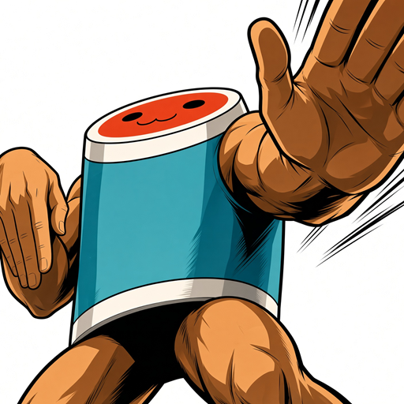

# A Better Taiko Hiroba

[中文](README.zh-CN.md)

A client-side toolkit for Donder Hiroba (donderhiroba.jp), the Japanese play-data site for Taiko no Tatsujin. It browses and changes your own play data — scores, profile, My Don, favourite songs, settings — from a desktop app, an Android app and, later, the command line, with an interface that stays out of your way. It runs on your own device and talks to Hiroba directly; none of your data passes through a server of ours.

## Download

Get the latest version from the [Releases page](https://github.com/HicirTech/A-Better-Taiko-Hiroba/releases/latest): an installer or a portable zip for Windows, a disk image for macOS (Apple silicon or Intel), and an APK for Android. The app tells you when a newer version is out.

## What it does

- [x] Sign in with your Bandai Namco ID and stay signed in
- [x] Show every chart you played: crowns, ranks, scores, hit counts, play options
- [x] Show your profile, My Don, title, dan rank, score counts and favourite songs
- [x] Show your recent plays, each opening its chart's scores in full, or adding its song to a set
- [x] Work out your rating and skills from your scores, and show the charts it counts
- [x] Change your title
- [ ] Build your title part by part
- [x] Change your nickname
- [x] Change My Don's costumes and colours
- [x] Preview a costume before saving it, and go back to one you wore before
- [ ] Change your game settings
- [x] Change your favourite song and your favourites folder
- [x] Keep sets of favourite songs on your device, and swap the whole folder for one in a single save
- [x] Find songs by genre, difficulty and stars, and by part of a name in Japanese, English or Chinese, with the artists and each chart's star level
- [x] Look up any song from the Overview, or open one from your favourites: its tempo, each chart's level and max combo, and pictures of its notes that open full screen and zoom
- [x] See how many notes a chart asks for each second, as a line over the song, branch by branch
- [x] See each chart drawn from its TJA file, every branch at once, or taiko.wiki's pictures of it, as you choose
- [x] See what the app is asking each site, and how each request went, on a page of its own
- [ ] Browse offline, from a local database
- [ ] Hold several accounts at once
- [ ] Sync incrementally, and resume where it stopped
- [ ] Run on the command line
- [x] Run as a desktop app, on Windows
- [x] Run as a desktop app, on macOS
- [x] Run as an Android app
- [ ] Run as an iOS app — later
- [ ] Run as a web app — later
- [ ] Drive the same core from a script, through a programmatic API
- [x] Speak English, Japanese, Simplified Chinese and Traditional Chinese
- [x] Tell you when a newer version is out
- [ ] Upload your scores to Kinoko

## Honest notes

**Unofficial.** This project is not affiliated with, endorsed by, or connected to Bandai Namco Entertainment. Taiko no Tatsujin and Donder Hiroba are theirs.

**Polite by default.** Hiroba is someone else's service. The app sends it at most five reads at once and one write at a time, never retries a request by itself, fetches each picture once and keeps it, and stops asking the moment you sign out. Fetching more is always something you ask for, never something that happens on its own.

**Song data from the community.** Artists, star levels, tempos and the songs' names in other languages come from [taiko.wiki](https://taiko.wiki/) and the Chinese [太鼓之達人維基](https://taiko.fandom.com/zh/) (its names are used under CC BY-SA). The pictures of the charts are drawn with [TJA Renderer](https://github.com/jack9966qk/TJARenderer) (MIT), or, as Settings choose, are those taiko.wiki links, on its own host, on the [太鼓の達人 譜面とかWiki](https://wikiwiki.jp/taiko-fumen/) and on Imgur. The rating is worked out as [OurTaikoWiki](https://github.com/OurTaiko/OurTaikoWiki)'s first rating does (MIT), from the chart constants and measurements that [FumenDB](https://fumen-database.com/) makes and OurTaiko publishes. A chart's note density, and the picture drawn of it, are read from [ESE](https://ese.tjadataba.se/ESE/ESE), the TJADB community's chart files, matched to songs by OurTaiko's map; the app keeps only the counts and the pictures, never a chart. The app reads what they publish and sends them nothing of yours.

**Your account, your call.** The toolkit signs in as you and can change your real Taiko profile. The account it touches is yours, and so is the responsibility.

## More

- [Wiki](https://github.com/HicirTech/A-Better-Taiko-Hiroba/wiki) — how Donder Hiroba itself works: every page, every write endpoint with its real request and response, and what is still unknown

## License

[MIT](./LICENSE).
